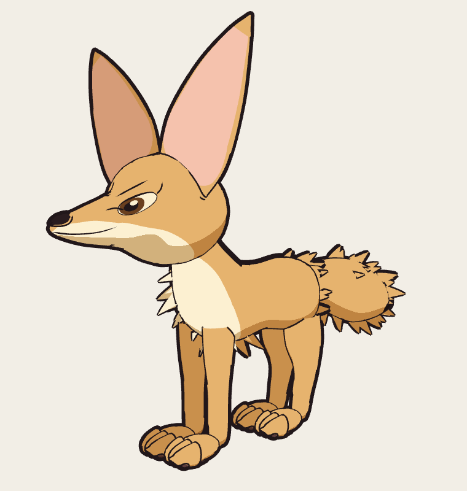
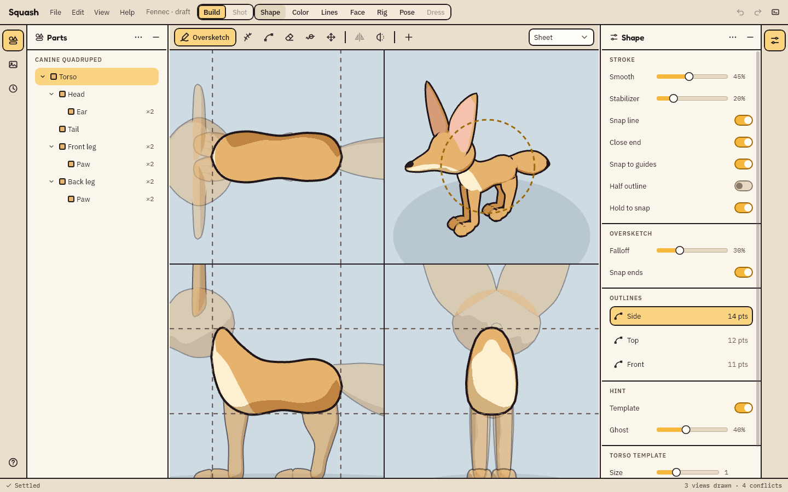
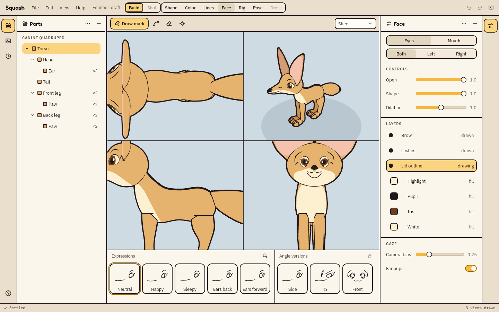
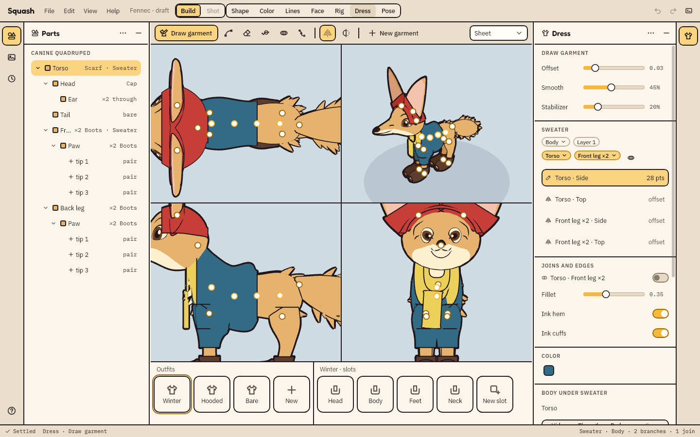
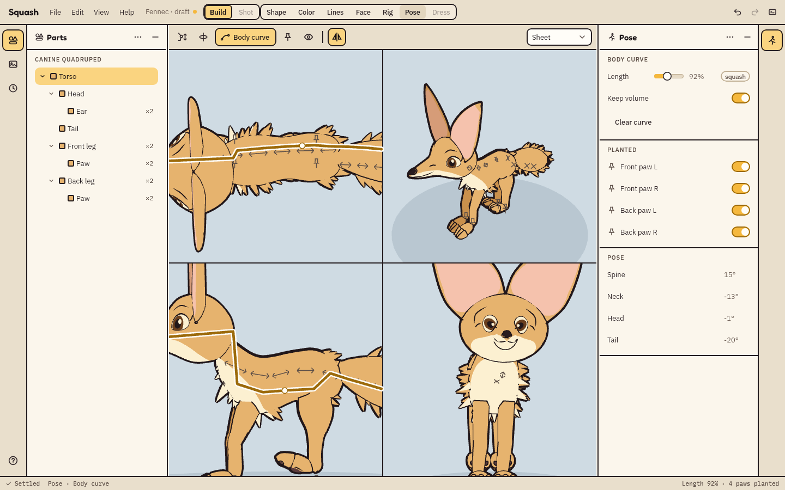
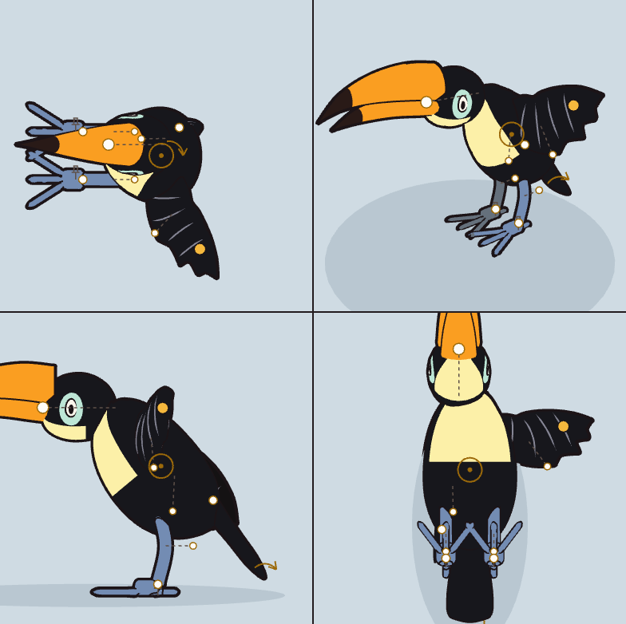
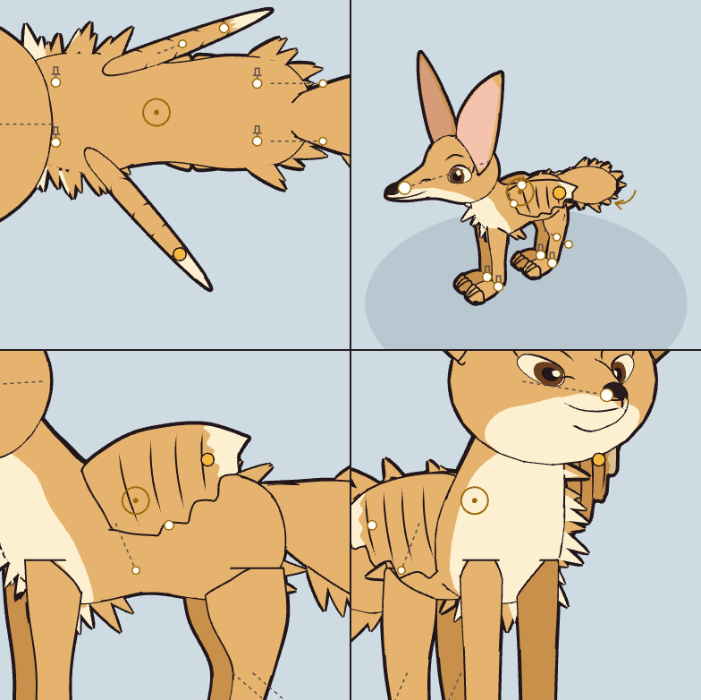
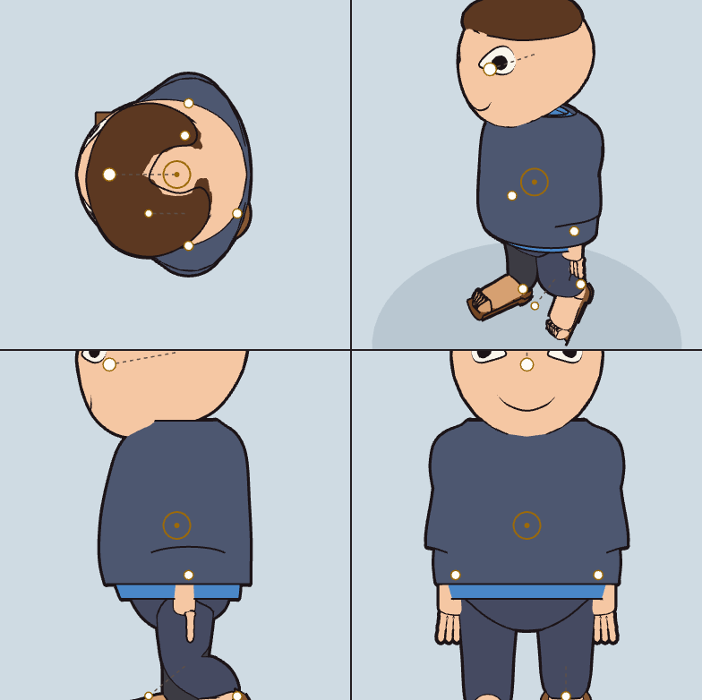

# Squash

A desktop tool for making cel-shaded, outlined cartoon characters. Draw a part once from a few views, Squash builds a 3D body from it, and you pose that body as many times as you like. The look comes from comic line work: a thick outer outline, thinner interior lines, flat color, and fur, eyes and mouths drawn as marks on the body's surface.

<p align="center"></p>

Every character is a real 3D body underneath, built from part templates (torso, head, leg, paw, tail, wing, beak, fin and more) shaped by the outlines you draw. Turn the camera and you see the underside of a paw; pose the body and the lines, fur and face follow it.



## Features

| Area | What you can do |
| --- | --- |
| New character | Start from a body plan (canine quadruped, bird, biped, fish) with its parts in a rest pose, or from a blank tube and add anatomy by hand |
| Shape | Draw each part's outline in its Side, Top and Front views; Squash sizes the part's 3D template from them. Oversketch, edit curves, erase and smooth, with a stabilizer, snapping to guides, a held stroke that snaps to a clean shape and pen pressure |
| Parts and sockets | Add parts on open sockets, move a socket across its parent's surface, add sockets, joints and landmarks, and pair parts so the far side mirrors the near one with per-side overrides |
| Layouts | Sheet (Top, Side, Front and a free 3D view), Focus, Full first and Single, with zoom and pan in every pane and conflicting views highlighted in place |
| References | An image board for inspiration, a color picker over its images, and trace images placed behind or over any view |
| Color | Fill, soft brush, curve-bordered regions and a color picker, all painted on the body's surface; flat or two-tone shading with the far side of each pair darker |
| Lines | Line weight painted on the body, interior strokes on the surface or floating off it (whiskers), fur along the silhouette with a comb, creases where parts meet, and taper |
| Face | Eyes and mouth as layered marks, with versions for front, three-quarter and side views that switch as the camera turns, a set of expressions, and a gaze target |
| Rig | A skeleton from each part's joints, weights seeded from which part owns each area, and paint, erase and smooth brushes for the seams |
| Dress | Garments drawn as shells over the body, with joins, hems and cuffs, holes for parts that come through, layers, outfits with named slots to mix and match, and loose ends that swing with follow-through |
| Pose | One body curve for spine, neck, head and tail, which can stretch or squash the body while keeping its volume; limbs dragged by hand, with planted paws held in place |
| Files | Undo for every change, a history of steps, recent files on Home, and characters saved as JSON with a JSON Schema for the format |







The same tools build any creature, from a bird to a winged fennec to a person.

<p align="center">
  
  
  
</p>

## Local development

### Requirements

- JDK 25, set as `JAVA_HOME`. Gradle fetches everything else, including the JetBrains Runtime the app runs on.
- Windows and a GPU with WebGPU support through wgpu-native. The 3D panes are native GPU surfaces.
- A checkout of [Stretch](https://github.com/nrc4867/stretch), the app shell Squash is built on. Squash builds it from source as a composite build, from a sibling folder named `stretch`, or from the folder set in `~/.gradle/gradle.properties`:

  ```properties
  stretch.dir=C:/path/to/stretch
  ```

### Build, run and test

```
./gradlew :app:run                   # the app
./gradlew check                      # the tests, with no window and no GPU
./gradlew check -Pslow               # also the smoke tests and benchmarks, which need a GPU
./gradlew :app:createDistributable   # the packaged app, under app/build/compose/binaries/main/app/Squash
```

Example characters are in `examples/`; open one with File, Open. Stop a running app before rebuilding it.

### Generated files

Schemas and icons are generated and committed, and `check` fails when they are stale:

```
./gradlew generateSchemas            # JSON Schemas for the file format, into schema/
./gradlew :ui-design:generateIcons   # icons from design/icons/*.svg
```

### IntelliJ IDEA

Open the folder. The Squash, Check and Smoke run configurations are included, and Stretch shows up as an included build.

### Where things are

The design lives in `docs/hld/`, one file per area: [architecture](docs/hld/architecture.md), [data model](docs/hld/data-model.md), [parts](docs/hld/parts.md), [pipeline](docs/hld/pipeline.md) and [look](docs/hld/look.md). Each Gradle module is a layer, and a module only depends on the layers below it: `geom`, `graph` and `document` at the core, `character` and `rig` for the domain, `render` and `ui-design` for presentation, the `screens-*` modules for the interface, and `app` on top.

## License

AGPL-3.0-only. See [LICENSE](LICENSE) and [NOTICE](NOTICE).
